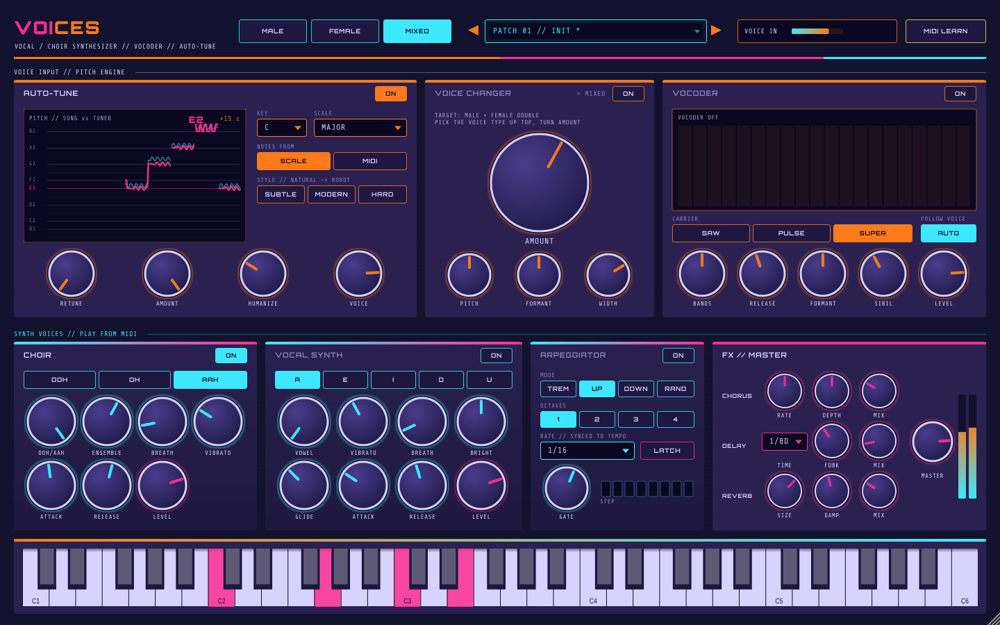
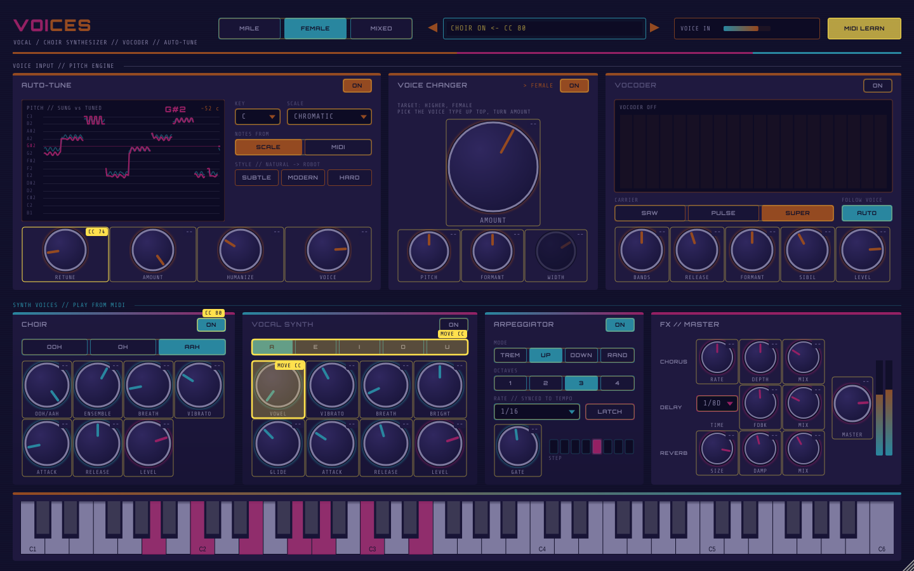

# Voices
Vocal synth // choir // vocoder // auto-tune // voice changer

A lush vocal instrument and vocal effect in one (JUCE, VST3 + Standalone), in the same
look as [Decu6000](https://github.com/LexLongcoding/Decu6000). Free and open source - see [License](#license).

## What you get
| File | What it is | Use it for |
|---|---|---|
| **Voices.vst3** | Instrument | Choir "oohs / aahs", the vowel vocal synth and the vocoder, played from MIDI. A side-chain input ("Voice In") feeds your voice to the vocoder and auto-tune. |
| **Voices FX.vst3** | Insert effect | Put it on a vocal track: auto-tune and the voice changer. It also accepts MIDI (vocoder carrier, MIDI-controlled tuning, synths). |
| **Voices** (Standalone) | App | Sing into your microphone and hear everything live; play the on-screen keys or a MIDI keyboard. |

All three share the same sound engine, patches and editor.

## The sections
**Header** - **MALE / FEMALE / MIXED** switches the whole instrument: the choir's sections,
the vocal synth's voice, the vocoder's character and the voice changer's direction.
The LCD shows the patch (click for the patch menu, arrows to step) and the value of the
knob you're turning. **VOICE IN** shows your input level (and the latency in Voices FX).

**AUTO-TUNE** - pitch correction on your voice, from barely-there to fully robotic.
- **KEY** and **SCALE** (chromatic, major, minor, harmonic minor, pentatonics, blues, dorian,
  mixolydian, phrygian). **NOTES FROM: MIDI** tunes to the notes you hold on a keyboard instead.
- **RETUNE** - how fast notes snap: **0 ms** = the hard, stepped hip-hop effect; ~40 ms = modern
  pop; 150 ms+ = transparent. **AMOUNT** - how much of the way to the note. **HUMANIZE** - lets long
  notes relax so natural vibrato survives while note changes still snap.
- **STYLE** buttons set all three at once: **SUBTLE**, **MODERN**, **HARD**.
- The screen shows what you sing (cyan) against what comes out (pink), the target note and
  how many cents you were off. **VOICE** is the level of your (processed) voice in the mix.

**VOICE CHANGER** - pick MALE / FEMALE / MIXED in the header and turn **AMOUNT**. Pitch and
formants (the "size" of the throat) move together, so it sounds like a different person, not a
sped-up tape. MIXED layers a male and a female version left and right (**WIDTH**). **PITCH** and
**FORMANT** fine-tune on top.

**VOCODER** - your voice shapes a built-in synth, 8-32 bands. Play chords on MIDI, or leave
**AUTO** on: with no keys held the vocoder sings the pitch you sing (through auto-tune) - the
classic robot voice with no keyboard needed. **CARRIER** SAW / PULSE / SUPER (detuned stack),
**RELEASE** (smooth vs. choppy), **FORMANT** shift, **SIBIL** lets "s" and "t" through for clarity.

**CHOIR** - the classic keyboard "Choir Aahs / Voice Oohs", synthesised: every note is an ensemble
of 8 singers, each detuned and drifting with their own vibrato and place in the stereo field.
**OOH / OH / AAH** buttons and a morph knob, **ENSEMBLE** (spread), **BREATH**, **VIBRATO**,
**ATTACK**, **RELEASE**. MIXED splits each note between a male and a female section.

**VOCAL SYNTH** - a solo singing voice with **vowel selection A E I O U** (and morphing in between
with the VOWEL knob), natural delayed vibrato, **BREATH**, **BRIGHT**, **GLIDE** between notes.
MIXED makes it a duet with a male voice an octave below.

**ARPEGGIATOR** - for the choir, vocal synth and vocoder. **TREM** (the chord repeats), **UP**,
**DOWN**, **RAND**; **1-4 OCTAVES**; **RATE** 1/4 to 1/32 including triplets, synced to your DAW's
tempo (bar-synced while playing, starts the instant you press a key while stopped); **GATE**;
**LATCH**.

**FX // MASTER** - **CHORUS** (3-voice stereo), tempo-synced ping-pong **DELAY** with darkening
repeats, a lush 8-line **REVERB**, master level with soft limiting, output meters.

The **keyboard** along the bottom plays the synths (C1-C6) - handy in the Standalone.
Double-click any knob to reset it; the window resizes from the bottom-right corner.

**MIDI LEARN** - control Voices from the knobs and faders of a MIDI controller (same as Decu6000).
Click **MIDI LEARN** in the header: every control that can be learned gets an outline with its CC.
Click a knob, switch or button row, then move a knob or fader on your controller - done. Right-click
a control to clear it; click it again or press Esc to cancel; Esc or the button again leaves learn
mode. Outside learn mode, right-click any knob > *Learn MIDI CC...* does the same for one knob.
Right-click the MIDI LEARN button to clear every assignment. Assignments are saved with your DAW
project (not with patches), CC 64 stays the sustain pedal, and CC 120-127 are never mapped.

## Hearing it live
- **Standalone:** Options -> Audio/MIDI Settings, pick your mic and (optionally) a MIDI keyboard.
  Use headphones, then click *Settings...* on the yellow "Audio input is muted" bar and untick
  *Mute audio input*.
- **In a DAW:** put **Voices FX** on your vocal track and turn on the track's input monitoring /
  record-arm. You hear the tuned / changed voice while you sing, before recording.
  Latency is about 12 ms (reported to the DAW so recorded takes line up).
  The instrument plays its synths with no added latency.

## Routing recipes
- **Auto-tune / voice changer:** Voices FX as an insert on the vocal track.
- **Choir, vocal synth:** Voices on an instrument / MIDI track.
- **Vocoder, with chords:** either
  - Voices (instrument) on a MIDI track, side-chain input = your vocal track, or
  - Voices FX on the vocal track and route a MIDI track to it (works in DAWs that send MIDI to
    effects, such as Reaper, Cubase and Bitwig; in Ableton Live use the instrument with side-chain).
- **Vocoder, no keyboard:** Voices FX on the vocal track, VOCODER on, AUTO on, VOICE turned down.

## Patches
13 factory patches: INIT, CATHEDRAL AAHS, VOICE OOHS, SUBTLE POLISH, HARD TUNE // TRAP,
ROBOT CHOIR, DAFT VOCODER, DIVA LEAD, ANGEL ARP, TREM VOICES, DEEP VOICE, ANIME GIRL, DUET DOUBLE.
User patches are small `.voicespatch` files (Save / Save As in the LCD menu):
- Windows: `%APPDATA%\Voices Synth\Patches`
- macOS: `~/Library/Voices Synth/Patches`
- Linux: `~/.config/Voices Synth/Patches`

Patches aren't exposed as DAW programs (same reason as Decu6000 0.9.1), but DAW presets still
save the full state. Your session remembers the patch and any unsaved tweaks.

## Getting builds
### Easiest: let GitHub build it (Windows + Linux, no compiler needed)
`.github/workflows/build.yml` builds both plug-ins and the Standalone on GitHub's machines,
exactly like Decu6000:
1. Create a new repository (e.g. `voices`) and upload the *contents* of this folder -
   including the hidden `.github` folder (GitHub Desktop: *File > Add local repository*, then
   *Publish repository*).
2. Open the **Actions** tab - "Build Voices" starts by itself (about 10-15 minutes).
3. Download **Voices-Windows** and/or **Voices-Linux** from the run's *Artifacts*.

**Publishing a release:** Actions -> *Build Voices* -> *Run workflow*, type a version such as
`v0.1.0` under *Release version*.

### Build it yourself
Requires CMake 3.22+, a C++17 compiler and internet access (JUCE 8.0.4 is fetched on first configure).

**Windows** - Visual Studio Community 2022 or newer ("Desktop development with C++") and CMake:

    cmake -B build -A x64
    cmake --build build --config Release

**Linux** (Debian/Ubuntu package names):

    sudo apt install build-essential cmake git libasound2-dev libjack-jackd2-dev \
        libfreetype6-dev libfontconfig1-dev libx11-dev libxcomposite-dev libxcursor-dev \
        libxext-dev libxinerama-dev libxrandr-dev libxrender-dev libgl1-mesa-dev
    cmake -B build -DCMAKE_BUILD_TYPE=Release
    cmake --build build --parallel

Output: `build/Voices_artefacts/Release/VST3/Voices.vst3`, `build/VoicesFX_artefacts/Release/VST3/Voices FX.vst3`
and `build/Voices_artefacts/Release/Standalone/`. See `packaging/INSTALL-*.txt` for where to put them.

## Tests
**DSP self-test (no JUCE needed)** - synthesises an off-key singer and checks every engine
(hard tune lands within ~1-2 cents of the scale, the changer shifts exactly +-6 semitones,
the pass-through is bit-exact, levels, the arp's timing, stability at extreme settings, CPU):

    cd Tests && c++ -std=c++17 -O2 -I../Source engine_render_test.cpp -o engine_test && ./engine_test

It writes WAV files of each engine you can listen to. **Plug-in tests** (processor, every factory
patch, state save/restore, editor screenshots, and a VST3 host test that loads the built
plug-ins like a DAW): configure with `-DVOICES_BUILD_TESTS=ON` and run
`VoicesTests <screenshot-folder> <Voices.vst3> <Voices FX.vst3>`.

## How it works (short version)
- Pitch detection: YIN on a 12 kHz copy, refined at full rate, 3-frame median (65-1100 Hz).
- Pitch shifting: real-time TD-PSOLA with pitch-synchronous marks; grains are resampled to move
  formants independently of pitch (voice changer). Fixed 12 ms latency.
- Choir / vocal synth: band-limited (polyBLEP) sources through 5-formant vowel filters with
  per-singer drift and vibrato. Vocoder: 4th-order band-pass analysis / synthesis banks.
- Reverb: 8-line feedback delay network with Hadamard mixing, diffusers and modulation.

The DSP lives in `Source/DSP/` and is JUCE-free; `docs/PROJECT-NOTES.md` has the design notes.

## License
Voices is free software: you can redistribute it and/or modify it under the terms of the
**GNU Affero General Public License v3.0 or later** (see [`LICENSE`](LICENSE)).
It is built with [JUCE](https://juce.com), used under the AGPLv3. Fonts are under the SIL Open
Font License (shared with Decu6000). See [`THIRD-PARTY-NOTICES.md`](THIRD-PARTY-NOTICES.md).
